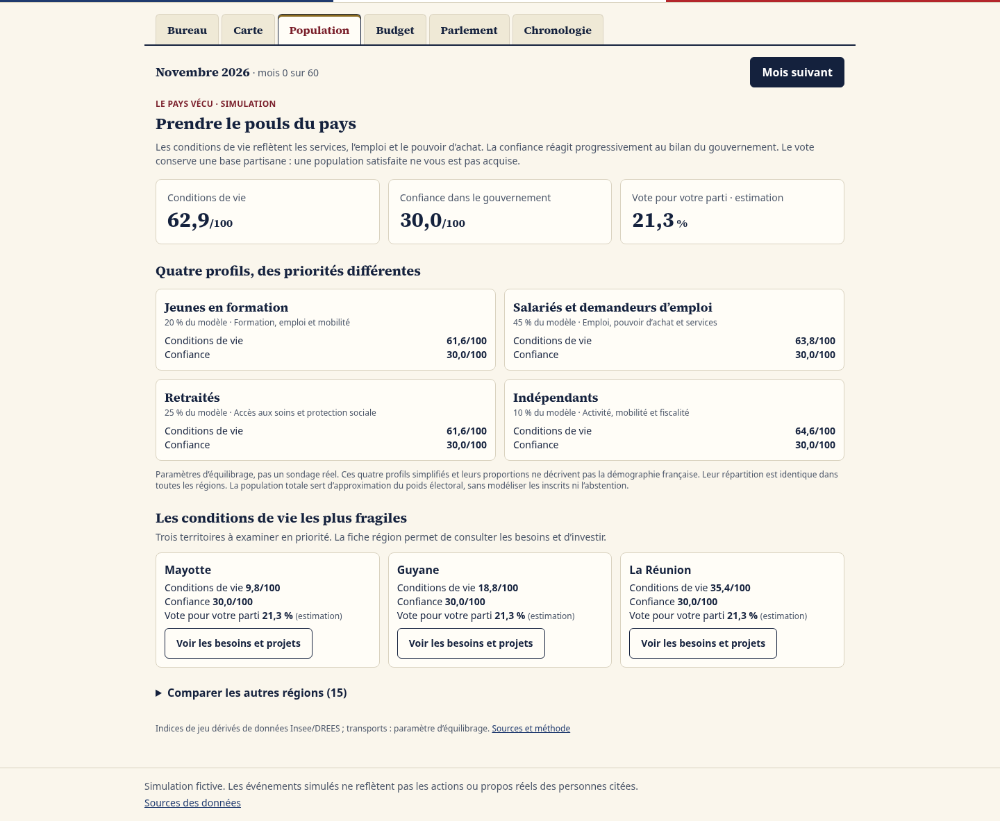

# Hémicycle

Simulation politique de la France, au tour par tour : **1 tour = 1 mois**. Le jeu démarre sur la situation réelle de novembre 2026.

> ⚠️ Simulation fictive. Les événements simulés ne reflètent pas les actions ou propos réels des personnes citées.


## Jouer
- En ligne : https://tamalou25.github.io/hemicycle/
- En local, depuis la racine du projet :
  ```bash
  python3 -m http.server 8000
  ```
  puis ouvrir http://localhost:8000

## Développement
```bash
npm ci
npm test
npm run build:css
```

| Dossier | Rôle |
|---|---|
| `src/engine/` | Moteur pur, testé, sans accès au DOM : effets différés, vote, tour, sondage, sauvegarde |
| `src/ui/` | Écrans et composants (JavaScript vanilla, Tailwind compilé localement) |
| `src/data/` | Partis, situation de départ et lois, au format JSON |
| `docs/SOURCES.md` | Sources des données, avec leur date de collecte |

## Fonctionnalités
### Phase 6 : Partage
- **Défis** : un lien `#defi=…` reproduit le même départ et le même hasard pour un ami
- **Classement local** : les 10 meilleurs bilans, stockés sur l'appareil
- Multijoueur et backend : voir l'[ADR 0001](docs/adr/0001-multijoueur.md) (décision reportée)

### Phase 5 : Profondeur
- 18 événements fictifs (grèves, crises, Europe, climat, santé, scandale dans l'entourage du joueur), chacun avec 2 ou 3 réponses
- Budget annuel du Premier ministre : leviers dépenses et impôts
- Bilan noté sur 100 et fins multiples (réformateur, gestionnaire, mandat chaotique, renversé, Élysée…)
- Non fait : régions (reporté)

### Phase 4 : Élections
- Calendrier réel : présidentielle d'avril 2027, européennes et législatives de 2029
- Campagne : meeting, débat, programme ; élan de campagne ; candidature à partir de 15 % de popularité
- Présidentielle à deux tours avec report des voix, législatives avec prime majoritaire, dissolution (art. 12)
- Résultats **simulés**, présentés par parti (« Candidat·e du parti X »)

### Phase 3 : Politiciens réels
- Mode « jouer un élu » : 15 personnalités actuelles, avec leur fonction sourcée et des avatars à initiales (aucune photo)
- Réactions probables au texte en cours, sans guillemets et avec un badge **SIMULATION**
- Section prévue pour les citations vérifiées : aucune n'a pu être sourcée à l'identique, donc aucune n'est incluse

### Phase 2 : Institutions
- Rôle au choix : député·e, ou Premier ministre (fictif)
- Navette parlementaire : Assemblée, Sénat, CMP, lecture définitive, Conseil constitutionnel
- 49.3 et motion de censure (289 voix requises), y compris des motions spontanées
- Amendements de compromis et accords de soutien de 6 mois avec les groupes
- Composition réelle des groupes à l'Assemblée et au Sénat (novembre 2026)

### Phase 1 : MVP
- Création du personnage : identité, 6 axes idéologiques, 4 compétences
- 7 indicateurs : chômage, croissance, déficit, dette, inflation, popularité, tensions sociales
- 12 lois, chacune avec des conséquences différées
- Vote à l'Assemblée pondéré par les sièges
- Sondage mensuel
- Sauvegarde automatique, plus export et import d'un fichier JSON

Les phases v1 sont conservées. Roadmap v2 : E0 fondations, E1 territoires et E2 finances livrés ; E3 population développé ; E4 secteurs, E5 politique reliée, E6 PWA puis E7 mobile à venir. Le backend reste reporté.

## E3 — Population

L’onglet **Population** distingue les conditions de vie, la confiance dans le gouvernement et les intentions de vote. Quatre profils agrégés ont des besoins différents ; les services locaux, l’inflation et les arbitrages budgétaires influencent leurs conditions de vie, puis leur confiance avec retard.

Les trois territoires les plus fragiles sont mis en avant. Leurs fiches donnent accès aux projets et aux besoins des groupes. Les résultats électoraux présentent les scores par région (premier tour pour la présidentielle).

Les proportions des profils sont **des paramètres de jeu identiques dans chaque région**, pas des statistiques démographiques. Les scores régionaux utilisent une base partisane nationale ; ils ne reproduisent pas la géographie électorale réelle. L’agrégation utilise la population comme approximation du poids électoral, sans inscrits ni abstention différenciée. Les sièges législatifs restent attribués par la formule nationale simplifiée existante.

Les sauvegardes v1 à v6 sont migrées en v7. Les populations sont initialisées au chargement d’une ancienne partie, sans effacer ses territoires ou ses projets.



### Tests navigateur

```bash
# Installer une fois le navigateur si Chromium n’est pas déjà fourni :
npx playwright install --with-deps chromium
npm run test:e2e
```

La configuration utilise `/usr/bin/chromium` quand il existe, sinon le navigateur géré par Playwright. `PLAYWRIGHT_CHROMIUM_EXECUTABLE` permet de sélectionner un autre exécutable. Python 3 démarre automatiquement le serveur HTTP de test. Les parcours sont exécutés à 1440 et 390 px : nouvelle partie, population, projet, passage de mois, reprise, import/export, migration v6 et élection régionale. Les captures et traces sont générées dans `test-results/` (ignoré par Git).
