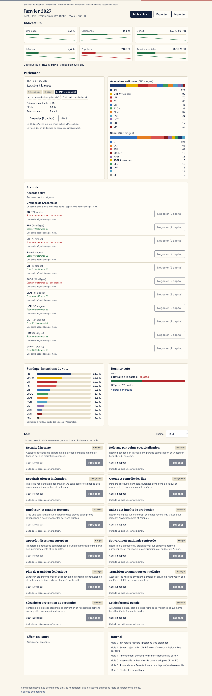

# Hémicycle

Simulation politique de la France, au tour par tour : **1 tour = 1 mois**. Le jeu démarre sur la situation réelle de novembre 2026.

> ⚠️ Simulation fictive. Les événements simulés ne reflètent pas les actions ou propos réels des personnes citées.



## Jouer
- En ligne : https://tamalou25.github.io/hemicycle/
- En local, depuis la racine du projet :
  ```bash
  python3 -m http.server 8000
  ```
  puis ouvrir http://localhost:8000

## Développement
```bash
npm install
npm test
```

| Dossier | Rôle |
|---|---|
| `src/engine/` | Moteur pur, testé, sans accès au DOM : effets différés, vote, tour, sondage, sauvegarde |
| `src/ui/` | Écrans et composants (JavaScript vanilla, Tailwind via CDN) |
| `src/data/` | Partis, situation de départ et lois, au format JSON |
| `docs/SOURCES.md` | Sources des données, avec leur date de collecte |

## Fonctionnalités
### Phase 6 : Partage
- **Défis** : un lien `#defi=…` reproduit le même départ et le même hasard pour un ami
- **Classement local** : les 10 meilleurs bilans, stockés sur l'appareil
- Multijoueur et backend : voir l'[ADR 0001](docs/adr/0001-multijoueur.md) (décision reportée)

### Phase 5 : Profondeur
- 18 événements fictifs (grèves, crises, Europe, climat, santé, scandale dans l'entourage du joueur), chacun avec 2 ou 3 réponses
- Budget annuel du Premier ministre : leviers dépenses et impôts
- Bilan noté sur 100 et fins multiples (réformateur, gestionnaire, mandat chaotique, renversé, Élysée…)
- Non fait : régions (reporté)

### Phase 4 : Élections
- Calendrier réel : présidentielle d'avril 2027, européennes et législatives de 2029
- Campagne : meeting, débat, programme ; élan de campagne ; candidature à partir de 15 % de popularité
- Présidentielle à deux tours avec report des voix, législatives avec prime majoritaire, dissolution (art. 12)
- Résultats **simulés**, présentés par parti (« Candidat·e du parti X »)

### Phase 3 : Politiciens réels
- Mode « jouer un élu » : 15 personnalités actuelles, avec leur fonction sourcée et des avatars à initiales (aucune photo)
- Réactions probables au texte en cours, sans guillemets et avec un badge **SIMULATION**
- Section prévue pour les citations vérifiées : aucune n'a pu être sourcée à l'identique, donc aucune n'est incluse

### Phase 2 : Institutions
- Rôle au choix : député·e, ou Premier ministre (fictif)
- Navette parlementaire : Assemblée, Sénat, CMP, lecture définitive, Conseil constitutionnel
- 49.3 et motion de censure (289 voix requises), y compris des motions spontanées
- Amendements de compromis et accords de soutien de 6 mois avec les groupes
- Composition réelle des groupes à l'Assemblée et au Sénat (novembre 2026)

### Phase 1 : MVP
- Création du personnage : identité, 6 axes idéologiques, 4 compétences
- 7 indicateurs : chômage, croissance, déficit, dette, inflation, popularité, tensions sociales
- 12 lois, chacune avec des conséquences différées
- Vote à l'Assemblée pondéré par les sièges
- Sondage mensuel
- Sauvegarde automatique, plus export et import d'un fichier JSON

Roadmap terminée (phases 1 à 6). Prochaine étape possible : backend avec rejeu anti-triche, voir l'ADR.
